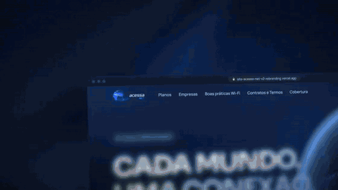
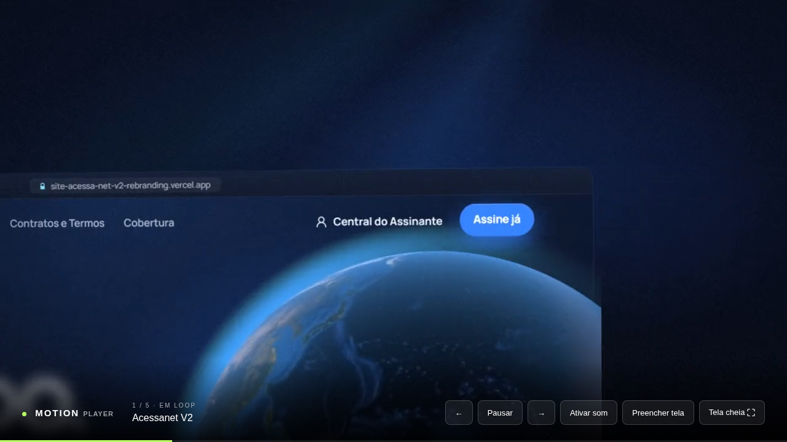
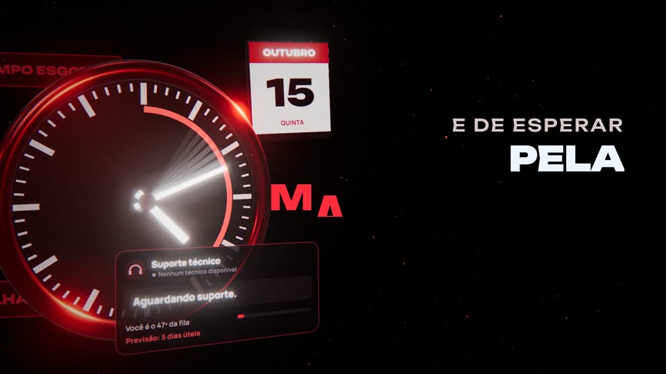
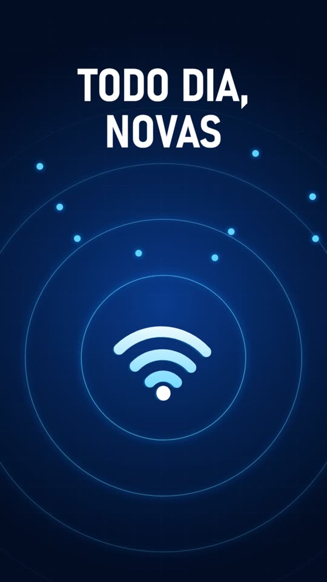

<div align="center">

# Motion Player

**Player de vídeos em loop para TV na rede local.**
Copie os vídeos para uma pasta e a playlist se monta sozinha.




</div>

---

## Como funciona

O servidor roda em uma máquina da rede (no meu caso, uma VM com PM2). A **TV só precisa abrir uma página no navegador**: ela busca a lista de vídeos, toca em sequência e volta ao primeiro quando acaba. Sem app para instalar na TV, sem conta, sem nuvem.



## Destaques

- **Playlist automática.** Solte arquivos `.mp4`, `.webm` ou `.m4v` em `public/motions/` e a lista atualiza sozinha a cada 30 segundos.
- **Pensado para TV.** Começa sem som para o navegador liberar o autoplay, pula vídeos incompatíveis e esconde os controles depois de 4 segundos sem interação.
- **Exibição flexível.** Mostra o vídeo inteiro, com faixas pretas quando precisa, ou preenche a tela. Funciona com vídeos horizontais e verticais.
- **Controles por teclado, mouse e toque.**
- **Zero dependências.** Servidor em Node.js puro, front em HTML, CSS e JavaScript. Não tem `npm install` nem etapa de build.
- **Streaming de verdade.** O servidor aceita requisições parciais (`Range`), então a TV pode avançar e retomar vídeos grandes sem baixar tudo de novo.

## Atalhos

| Tecla | Ação |
|---|---|
| `Espaço` | Reproduzir ou pausar |
| `←` / `→` | Vídeo anterior ou próximo |
| `F` | Tela cheia |
| `M` | Ligar ou desligar o áudio |

## Vídeos de exemplo

Os cinco motions que acompanham o projeto são peças de divulgação da AcessaNet. Clique na imagem para abrir o vídeo.

<table>
  <tr>
    <td align="center"><a href="public/motions/acessanet-v2.mp4"></a><br><sub>Acessanet V2</sub></td>
    <td align="center"><a href="public/motions/agenda.mp4"></a><br><sub>Agenda de técnicos</sub></td>
    <td align="center"><a href="public/motions/central-assinante.mp4"></a><br><sub>Central do assinante</sub></td>
  </tr>
  <tr>
    <td align="center"><a href="public/motions/anuncio-tv.mp4"></a><br><sub>Anúncio de TV</sub></td>
    <td align="center"><a href="public/motions/vertical.mp4"></a><br><sub>Versão vertical (9:16)</sub></td>
    <td></td>
  </tr>
</table>

## Como rodar

Requer Node.js 18 ou superior.

```bash
git clone https://github.com/Olukasao/Motion_Player.git
cd Motion_Player
npm start
```

Abra **http://localhost:9540** no navegador. Para usar em uma TV, abra `http://IP-DO-SERVIDOR:9540` no navegador dela, conectada à mesma rede.

| Variável | Padrão | Função |
|---|---|---|
| `PORT` | `9540` | Porta do servidor |
| `HOST` | `0.0.0.0` | Endereço de escuta |

### Em produção, com PM2

```bash
pm2 start ecosystem.config.cjs
pm2 save
```

```bash
pm2 status motion-player      # estado
pm2 logs motion-player        # logs
pm2 restart motion-player     # reiniciar
```

Para o player voltar sozinho depois de reiniciar o servidor, habilite o serviço de inicialização do PM2 (`pm2 startup`).

## Adicionar ou remover vídeos

Copie ou apague arquivos em `public/motions/`. A ordem é alfabética, então use prefixos como `01-`, `02-` para definir a sequência. Para a melhor compatibilidade com TVs, prefira **MP4 com vídeo H.264 e áudio AAC**.

## Estrutura

```text
server.cjs               servidor HTTP (arquivos estáticos, lista de vídeos e Range)
ecosystem.config.cjs     configuração do PM2
public/
  index.html             página do player
  style.css              visual e controles
  player.js              playlist, atalhos e controles
  motions/               vídeos e miniaturas
```

## API

| Rota | Resposta |
|---|---|
| `GET /api/videos` | Lista dos vídeos de `public/motions/`, em ordem alfabética |
| `GET /motions/<arquivo>` | O vídeo, com suporte a `Range` |

## Segurança

- O servidor entrega **somente a pasta `public`**, e qualquer caminho que tente sair dela é recusado (`403`).
- Aceita apenas `GET` e `HEAD`.
- **Não tem login.** Foi pensado para a rede local. Não exponha a porta na internet.

## Verificação

```bash
npm run check    # confere a sintaxe do servidor e do player
```

## Licença

Projeto de uso pessoal, publicado para fins de portfólio. Os vídeos de exemplo são conteúdo da AcessaNet e não podem ser reutilizados sem autorização.
